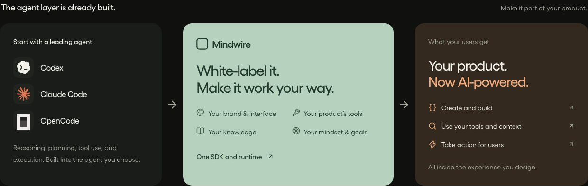

# Mindwire

**Your product. Powered by agents.**

Turn your product into an advanced AI experience without rebuilding the agent layer.
Mindwire lets you **white-label and customize leading agent harnesses** like Codex,
Claude Code, and OpenCode through an open-source SDK and runtime.

Reuse their planning, coding, tool use, and execution. Add your tools, knowledge,
instructions, and goals. Deliver the whole experience in your interface, under your brand.

[Website](https://mindwire.sh) · [Quickstart](https://mindwire.sh/docs/guides/quickstart) ·
[Documentation](https://mindwire.sh/docs) · [TypeScript](packages/sdk) · [Go](packages/daemon/sdk)

## Build your product. The agent layer is ready.

- **Adapt instead of rebuild.** Use native agent capabilities through one integration.
  Mindwire handles connections, sessions, authentication, and event translation.
- **Make it yours.** Connect product tools through MCP. Shape the work with your
  context, instructions, skills, and goals. Keep your brand and interface.
- **Go beyond answers.** Let users build apps, create finished assets, and complete
  workflows using your product’s capabilities.
- **Stay in control.** Stream progress, handle supported approvals, and run on your
  own infrastructure. Agent capabilities vary; see the [compatibility guide](packages/daemon/HARNESSES.md).



[See what this looks like inside a product →](https://mindwire.sh/#in-action)

## Get started

```sh
npm install mindwire
```

[Authenticate your agent](https://mindwire.sh/docs/guides/authentication), then run on
Node.js or Bun from a project containing `brief.md`. The SDK starts the local runtime.

```ts
import { Mindwire } from "mindwire";

const mw = new Mindwire({ agent: "codex" });
try {
  const run = await mw.turn({
    chatId: "launch",
    cwd: process.cwd(),
    message: "Build a website from brief.md, create campaign assets, and save a rollout plan.",
  });
  for await (const event of run) {
    if (event.type === "text") process.stdout.write(event.text ?? "");
  }
  await run.wait();
} finally {
  await mw.close();
}
```

Next: [connect your tools](https://mindwire.sh/docs/guides/mcp),
[stream work into your UI](https://mindwire.sh/docs/guides/streaming), or use
[Go](packages/daemon/sdk) / [REST](https://mindwire.sh/docs/reference/rest/turns-runs/post-turns).

[Mindwire Cloud](https://mindwire.sh/cloud) provides optional hosting.
The [Mindwire app](https://mindwire.sh/app) is a first-party client built on the same runtime.
Neither is required for your product.

## Contributing & license

See [Contributing](CONTRIBUTING.md) for local development.
The runtime, SDKs, website, and Console are **Apache-2.0**; the Apple app is
**source-available**. [License details](LICENSING.md).
